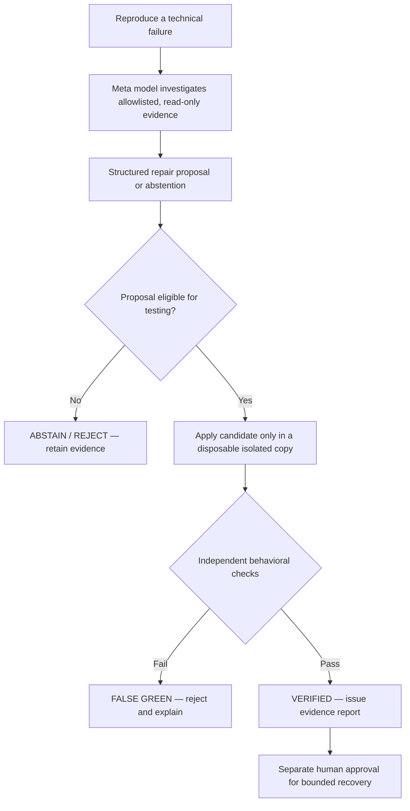

# 🛡️ Bravon
### Reliability, proven.

**AI proposes. Independent evidence decides.**

A verification-first engineering platform that lets Meta models investigate failures — but requires **independent, isolated behavioral proof** before a proposed fix is trusted.

**Meta Global AI Developer Hackathon 2026** · **Indie Developer** · **Push the Frontier**

[**Explore the live platform**](https://bravon-meta.vercel.app/) · [**Try the guided Proof Journey**](https://bravon-meta.vercel.app/#tour) · [**Inspect Meta evidence**](https://bravon-meta.vercel.app/muse) · [**Review the experiment's limitations**](#evidence-and-limitations)


---

## 🎬 Hackathon demo

**Animated product demonstration · 2 minutes 49 seconds · Team Bravon**

The new narrated video is being uploaded to YouTube. **The clickable video and thumbnail will be added here when its public/unlisted playback URL is confirmed.** No MP4 needs to be committed to this repository.

The video follows the complete story: **problem → solution → Meta-assisted investigation → independent verification → edge cases → impact → conclusion → thank you**.

> **Evidence note:** The film replays saved experiments. It does not perform live inference, Docker execution, or production repairs during playback.

## The problem

AI assistants can generate a plausible repair and pass a visible test while leaving the **actual behavioral contract broken**. A green test alone is not permission to touch infrastructure.

Bravon separates two responsibilities:

| Meta model | Independent verifier |
|---|---|
| Chooses bounded, read-only observations | Reproduces the failure in an isolated environment |
| Forms a root-cause hypothesis | Checks the candidate against public and hidden behaviors |
| Proposes a structured repair or abstains | Rejects incomplete or unsafe proposals |
| **Does not authorize execution** | Records a verdict; recovery requires explicit human approval |

## How Bravon works



The model never receives hidden tests, signing material, arbitrary shell access, or authority to decide the final verdict.

## What we built during the hackathon

**1. Bounded Meta investigation.** Local **Meta Llama 3.1 8B** runs through Ollama; a separately documented **Meta Muse Spark 1.3** investigation operated on a disposable DNS incident.

**2. False-green detection.** A repair that passes the visible regression but fails independent invariants is **rejected**, not called fixed.

**3. Evidence-first jury experience.** A read-only workspace, guided Proof Journey, Model Evidence page, and Muse Evidence page present recorded investigations without exposing live model or Docker controls.

**4. Immortality — an experimental transferable safety rule.** A verified DNS recovery on **System A** informed a bounded, non-executable `dns-gateway-binding` invariant evaluated against **System B**. One dangerous DNS change was **BLOCKED** and one legitimate standby move **ALLOWED** in the operator-reported isolated experiment.

The original in-memory simulator, disposable Docker lab, and several verification primitives **predated the hackathon**. The [dated build ledger](docs/HACKATHON_BUILD_LEDGER.md) separates those foundations from the features added during the event.

## Results you can inspect

| Evidence set | Recorded result | Scope |
|---|---|---|
| Local Meta Llama 3.1 8B | **9 investigations / 45 requests** | First-party evaluation fixtures |
| Verified local-model repair proposals | **4** | Passed independent checks |
| False-green model proposals rejected | **2** | Incomplete repairs stopped |
| Abstentions retained | **3** | **Not** counted as successes |
| Separate offline repair-candidate evaluation | **3 complete accepted / 3 incomplete rejected** | Six controlled fixture candidates |
| Operator-reported Muse DNS investigation | **7 hosted requests, 5 observations, 5 citations** | Separate from local Llama runs |
| Controller-reported clone verification | **5/5 checks** | One disposable DNS recovery, not external attestation |
| Experimental transfer on System B | **Unsafe BLOCK / legitimate ALLOW** | One DNS invariant and two predefined candidates |

See [machine-readable local-model evidence](docs/evidence/meta-evaluation.json), the [evaluation methodology](docs/HACKATHON_SUBMISSION_2026.md), and the [Immortality design and boundaries](docs/IMMORTALITY.md).

**These figures are fixture-specific.** They do not establish a general repair-success rate, system-wide immunity, or third-party attestation.

## Explore the working product

| Experience | What to inspect |
|---|---|
| [**Workspace**](https://bravon-meta.vercel.app/) | Recorded failures, proposals, checks and verdicts |
| [**Proof Journey**](https://bravon-meta.vercel.app/#tour) | Verified repair versus rejected false green |
| [**Meta Muse Evidence**](https://bravon-meta.vercel.app/muse) | Separately disclosed operator-reported DNS investigation |
| [**Model Evidence**](https://bravon-meta.vercel.app/model-trials) | Local-model outcomes, with synthetic controls clearly archived |
| [**Immortality**](https://bravon-meta.vercel.app/assets/immortality.html) | System A → bounded rule → System B; BLOCK versus ALLOW |
| [**Simulation**](https://bravon-meta.vercel.app/simulation) | Browser-contained deterministic learning example |
| [**Docker Lab**](https://bravon-meta.vercel.app/docker) | Read-only overview; live Docker controls are not public |

**Public safety boundary:** Visiting the website does not initiate model inference, launch containers, mutate incidents, or authorize a repair.

## Architecture and technology

| Layer | Technology / responsibility |
|---|---|
| Model investigation | **Meta Llama 3.1 8B** with local Ollama; separate recorded **Meta Muse Spark 1.3** experiment |
| Application and API | **Python**, **FastAPI**, **Pydantic**, read-only evidence endpoints |
| Isolated verification | Python test contracts, controlled fixtures, digest-pinned Docker worker |
| Experiment lab | Docker Compose, disposable CoreDNS / Nginx / HTTP infrastructure |
| Viewer | HTML, CSS, JavaScript; guided verdict and evidence displays |
| Evaluation and QA | pytest, Node.js tests, Chromium/WebKit browser checks, accessibility audits |
| Deployment | Vercel for the **read-only** public experience |

The verifier uses bounded inputs, resource limits, fixed targets, and HMAC-authenticated evidence envelopes. An HMAC is **not** a third-party signature or proof of independent execution.

## Run the read-only workspace locally

Requires **Python 3.10+**. This path does **not** require a model API key or Docker.

```bash
git clone https://github.com/S-h-u-b-h-1/bravon_meta.git
cd bravon_meta
python3 -m venv .venv
source .venv/bin/activate
python -m pip install -e '.[dev]'
python -m uvicorn proofops.api:app --host 127.0.0.1 --port 8000
```

Open **http://127.0.0.1:8000**. The default mode keeps Docker controls disabled.

To inspect the provided recorded evaluations without making a model request:

```bash
python -m proofops.hackathon_eval --meta-evidence-root docs/evidence --output /tmp/bravon-meta-evaluation.json
```

For the bounded **offline** release-contract audit (requires Node.js 22+):

```bash
bash scripts/offline-release-check.sh
```

The full Docker-dependent test suite needs its pinned image and an approved local Docker environment; it has **not** been qualified in this public snapshot. No command above starts real Docker or contacts a hosted model.

## Evidence and limitations

- **Local Llama** evidence is distinct from the **operator-reported hosted Muse** investigation. The latter's original private controller reports are not public or independently attested.
- **Immortality** means one experimentally transferred **DNS safety invariant** — **not** an autonomous immune network or universal recovery system.
- The public simulation is deterministic. The interactive site is a **recorded evidence viewer**, not a live production repair service.
- The GitHub-hosted Actions matrix was blocked before runner execution by the source account's usage budget. Offline test results are **not** represented as a successful hosted CI run.
- The project does **not** accept arbitrary repositories, run unknown commands on customer machines, or provide an unattended production repair endpoint.

For details: [evidence guide](docs/evidence/README.md) · [publication security audit](docs/PUBLICATION_SECURITY_AUDIT.md) · [third-party notices](THIRD_PARTY_NOTICES.md).

## Hackathon provenance and source privacy

This repository was created as a **privacy-preserving source snapshot** from a separate, privately held development history. Its initial root commit does **not** import the original Git authorship or dated commit objects.

- Source commit referenced by the export: `21e3efdd1b38e40de1ca6791a93aaa8013946a09`
- Frozen pre-event baseline referenced by the ledger: `b0dd80f721d28d36e9e680bb18181ae20d4d0347`
- Two fictional test-path fixtures were sanitized; the original/modified file hashes are recorded in [`PUBLIC_PROVENANCE.json`](PUBLIC_PROVENANCE.json).
- Subsequent **README and documentation-only** changes do not alter the frozen source baseline. The provenance manifest describes the **initial export**, rather than every later documentation edit.

**The public snapshot alone cannot independently prove the private development chronology.** See [Snapshot Notice](PUBLIC_SNAPSHOT_NOTICE.md) and [Hackathon Build Ledger](docs/HACKATHON_BUILD_LEDGER.md). The original history is retained privately for a controlled, privacy-reviewed organizer audit if needed.

## Team and licensing

**Team Bravon** · **Shubhaang Kataruka** — Indie Developer

Built for the **Meta Global AI Developer Hackathon 2026**, under **Push the Frontier**.

**License:** [MIT](LICENSE). Dependencies and model attribution are documented in [Third-Party Notices](THIRD_PARTY_NOTICES.md). No Meta model weights or private operator reports are distributed here.

---

**Bravon · Reliability, proven.**  
*AI proposes. Independent evidence decides.*
