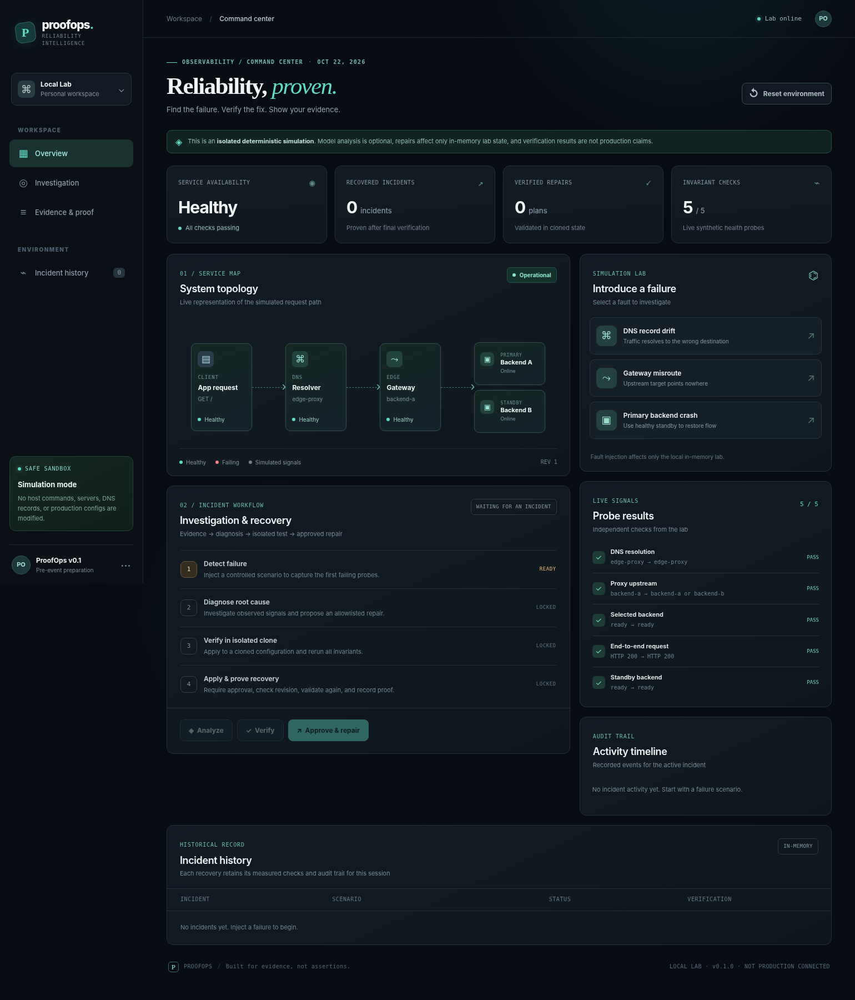
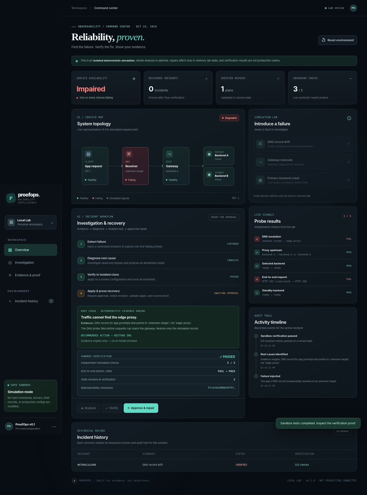
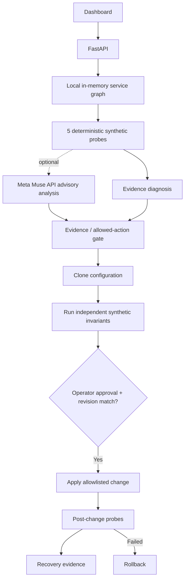

# Bravon · Reliability, proven

Bravon is a verification-first AI engineering platform built for the Meta
Global AI Developer Hackathon. It reproduces a genuine defect, lets a bounded
Meta model investigate read-only evidence, reviews the proposed repair, and
independently tests that repair before issuing a verdict.

**Live evidence workspace:** https://bravon-meta.vercel.app

The public deployment serves **read-only recorded evidence** and an optional **browser-contained deterministic simulation**. Public visitors cannot invoke Docker, contact hosted Muse, or mutate server incidents. The browser simulation has no server write permissions, Docker socket, model credentials, repair mutation route, or arbitrary-code endpoint.

## Hackathon-period result

- Three first-party domains: software, data processing, and infrastructure
  configuration.
- Nine actual local Meta Llama 3.1 investigations with 45 model requests and
  $0.00 API cost.
- Four model repairs independently verified, two false-green proposals
  rejected, and three abstentions preserved as unsuccessful runs.
- Six offline repair candidates: all three complete repairs verified and all
  three incomplete repairs rejected.
- Digest-pinned Docker worker with no network, read-only root, non-root UID,
  dropped capabilities, no-new-privileges, and bounded resources.

The measured results are fixture-specific, not a claim of general autonomous
software repair. See the [machine-readable evidence](docs/evidence/),
[evaluation method](docs/HACKATHON_SUBMISSION_2026.md), and
[publication security audit](docs/PUBLICATION_SECURITY_AUDIT.md).


## Immortality — experimental transferred safety invariants (hackathon-period)

**New experimental achievement, October 29:** One operator-reported real
official Meta Muse Spark 1.3 DNS investigation produced a verified recovery
on disposable System A. Bravon then compiled a fixed \`dns-gateway-binding\`
antibody. In a separately isolated Docker System B, the policy BLOCKED a
dangerous DNS change and ALLOWED a legitimate standby-routing control.
The unsafe change was physically tested only in B's disposable clone;
the active destination reportedly remained healthy, with cleanup recorded.

The operator's two JSON reports passed Bravon's read-only structural and
digest-linkage audit. This evidence is **self-reported by the controller**,
not independent cryptographic attestation. The physical experiment covers
one DNS rule and two predefined candidates. A worldwide antibody network,
arbitrary software repair, and a reusable production deployment gate are
**not implemented**.

- [Immortality architecture, tests and private CLI walkthrough](docs/IMMORTALITY.md)
- [New three-minute hackathon storyboard](docs/HACKATHON_DEMO_SCRIPT_3_MIN.md)
- Public browser evidence viewer: \`/assets/immortality.html\` (read-only). The owner-held source and transfer JSON reports are not deployed or automatically uploaded.
- The owner-held report has **not been published, committed, or uploaded**.

## Jury-friendly guided evidence review

Open [the Proof Journey](https://bravon-meta.vercel.app/#tour) to compare an actual recorded local Llama repair that passed with a false-green proposal that was rejected. The five-step walkthrough is a read-only replay; it does **not** claim to show a live official Muse request. The separate official Muse / Immortality experiment is documented in the private operator workflow and should be shown only from a sanitized, approved report.

## Official Meta Muse evidence bridge (experimental, read-only)

The new /muse page documents the distinct official Muse Spark 1.3 investigation of
a disposable DNS incident. The public site shows an honestly labeled source
summary without running the model. To present the full Source A → System B
record without local Docker, the operator can generate a minimal private
receipt **offline**, after the existing source-and-transfer consistency audit.
The browser reads that receipt from local file selection, with strict schema
and alteration checks. No original report, credentials, IPs or private logs
are uploaded. A local receipt is **not independent attestation** or owner
approval to publish.

See [the private receipt operator guide](docs/JURY_MUSE_RECEIPT.md).

## Experimental remote real-Docker qualification — operator controlled

Bravon now has a **draft, disabled-by-default GitHub Actions workflow** for
the existing three fixed real-Docker fault families. It can eventually run
against new, disposable services on an ephemeral GitHub-hosted runner, rather
than depending on the owner's Mac. This workflow requires the repository owner's GitHub identity, an
explicit owner-set repository opt-in variable, a fixed scenario, and an exact
confirmation before any real containers can start. It does not assume GitHub
private-environment reviewer features that may be unavailable on the owner's plan.

The public Docker page remains **read-only**. It can locally inspect a
minimized receipt generated by the remote qualification controller but
cannot launch a workflow, access GitHub Actions credentials or run Docker.
This qualification is deterministic **NOT Meta Muse**, not a production
remote repair product, and not independently attested.

**No authorized cloud Docker experiment has been executed in this
development branch.** See [the remote Docker owner runbook](docs/REMOTE_DOCKER_QUALIFICATION.md)
for operational gates, artifact privacy and evidence limitations.

## Reproduce the checked build

Prerequisites: Python 3.10+, Docker Desktop, and the pinned worker image.

```bash
python3 -m venv .venv
source .venv/bin/activate
python -m pip install -e '.[dev]'
docker pull 'python:3.12-alpine@sha256:b658b05ce9c4eb97ec6fc19424818a1f31993659c2b505a532f470e83807815d'
python -m pytest -q
python -m proofops.hackathon_eval \
  --meta-evidence-root docs/evidence \
  --output /tmp/bravon-meta-evaluation.json
uvicorn proofops.api:app --host 127.0.0.1 --port 8000
```

The committed Meta evidence was produced by local `llama3.1:8b` through
Ollama. Replaying the evaluation makes no model call and incurs no cost.

## Honest build boundary

The immutable pre-kickoff cutoff is annotated tag
`hackathon-start-baseline-2026-10-26`, peeled commit
`b0dd80f721d28d36e9e680bb18181ae20d4d0347`. Hackathon work starts at commit
`b8304dd` and is itemized in the [build ledger](docs/HACKATHON_BUILD_LEDGER.md).
The [live rules review](docs/META_HACKATHON_RULES_2026.md) confirms Meta
open-weight models are accepted in Stage One.

## Safety and limitations

- Hidden behavior tests and signing keys never enter model context.
- Repairs apply only to disposable copies of committed first-party fixtures.
- HMAC detects tampering by parties without the runner key; it is not
  public-key attestation or proof of organizational independence.
- Arbitrary third-party repositories and production infrastructure are blocked.
- No project license is selected yet; see [third-party notices](THIRD_PARTY_NOTICES.md).

## Pre-existing development archive

The sections below document the frozen research foundation and historical
ProofOps/Bravon versions. They are retained for provenance and are not presented
as hackathon-built functionality.

## v0.9 — Free-model diagnosis on disposable real Docker (EXPLICIT OPT-IN)

The hosted Nemotron agent can now investigate **real CoreDNS/Nginx/HTTP observations from the self-contained Docker demonstration**, but only through the explicit terminal command `python -m proofops.real_lab investigate --investigator openrouter-free --confirm-cloud 'SEND DISPOSABLE LAB PROBE DATA TO OPENROUTER'`. This transfers only bounded generated-lab observations (Docker-private IPs and health booleans) to a third party; it is disabled by default and requires the OpenRouter key. The model is pinned to `nvidia/nemotron-3.5-lightning:free` with **no paid fallback**. The normal UI investigation button stays rule-based; there is no automatic cloud traffic.

**New safety step:** `DockerLab.investigate` preserves the model's raw action but promotes a repair into the controller **only if the independent evidence gate accepts its real probe data and citations**. A rejected action is recorded as `raw_action` but becomes `action='none'`, so sandbox verification is blocked. Accepted repairs still require the second real Docker environment, revision/fingerprint checks, explicit approval and post-repair evidence. The new dashboard correctly distinguishes free-model results from rule-based ones.

The user's earlier **synthetic** three-case Nemotron trial achieved 3/3 correct decisions, 0 unsafe proposals, and 21 free requests; the live Docker-model bridge **has not yet been run on the user's Mac**. See [the opt-in real-Docker AI runbook](docs/REAL_DOCKER_FREE_MODEL_V09.md) for exact steps and the external-data disclosure.

## v0.8.3 — Evidence-aware repair choices (no paid AI)

- Hosted models may **choose which probe to call**; no non-abstain repair is offered until its minimum independent probe coverage is available. This is not a hidden answer and does not bypass the `assess_proposal` semantic gate.
- Dashboard scorecard distinguishes a correct raw decision from a **gate-qualified** decision. Gate rejections are not mislabeled as unsafe model proposals.
- HTTP dashboard tests no longer depend on whether a developer already generated a live report under `reports/`.
- Do not reapply v0.8.1 → v0.8.2 patch. Upgrade once from v0.8.2, or use the full v0.8.3 package in a clean folder.

> **v0.7.2 local-Llama finalization fix:** The real Mac Llama run completed six read-only probes but its eighth model request hit the final-explanation token limit. v0.7.2 sends a smaller final prompt, permits up to 512 output tokens for the schema-constrained final, and—only when that response hits a token limit—makes one bounded local JSON-mode retry (1024 tokens) with the same strict evidence validation. No repair is executed. This fix passed mocked local tests, **not yet a fresh live Llama run**. See [v0.7.2 troubleshooting](docs/LOCAL_LLAMA_V072.md).

## v0.8.1 — Inspect the model's work (free API remains optional)

This incremental update adds a **three-scenario model-trial scorecard**, without changing
real Docker recovery, repair permissions, or the evidence gate. It displays a model's
**raw proposed action**, whether the gate rejected it, each read-only probe, and reported
request/token usage. The generated HTML is standalone and needs no web server.

```bash
python -m proofops.model_trials preview                 # no key, no requests
open docs/model-trials-v081-DEMO-MOCK.html              # MOCK preview, not live AI
python -u -m proofops.model_trials run \
  --confirm 'RUN THREE FREE MODEL TRIALS' \
  --output reports/model-trials-v081.json               # explicitly opt in; up to 30 free requests
open reports/model-trials-v081.html
```

You can also open **http://127.0.0.1:8001/model-trials** from the existing
ProofOps server after restarting it with v0.8.1. Until a real trial suite exists,
this route displays an unmistakably labeled **mock preview**.

The free trial does **not** execute repairs or submit Docker/host data. A valid
`OPENROUTER_API_KEY` is required only for the explicit `run` command. The free tier may
be throttled; we do not automatically select a paid model. To render previously saved
single-case reports with **zero** additional requests, use `python -m proofops.model_trials
render reports/free-dns-v08.json --output reports/scorecard.json`. See
[docs/MODEL_TRIALS_V081.md](docs/MODEL_TRIALS_V081.md).


> **v0.7 model-ready investigation protocol & optional local Meta Llama — pre-event development prototype.** A local simulation plus a separate disposable real-Docker recovery lab, built in advance of the Meta Global AI Developer Hackathon. **This is not a contest submission, nor a production self-healing system.** Official competition rules were not yet published when this prototype was prepared on October 23, 2026. Check those rules before reusing any pre-event code in a submission.

## v0.7 — Strict model step protocol and optional local Meta Llama (no cloud API key)

The v0.7 module `proofops.model_protocol` accepts **one JSON step** per turn from an interchangeable provider: a named read-only tool request, or a cited final proposal. It rejects malformed instructions, unauthorized tools/arguments, repeated probes, invented evidence IDs and unsafe outputs before the proposal can reach the existing independent recovery verifier. It preserves the proven real-Docker repair/approval code from v0.4.1. The default emulator is deterministic **NOT AI**, purely to test this interface. See [docs/MODEL_CONTRACT_V07.md](docs/MODEL_CONTRACT_V07.md).

```bash
python -m proofops.model_protocol run --cases 42 --seed 20261023 \
  --output reports/model-wire-v07.json
python -m proofops.model_protocol verify-report reports/model-wire-v07.json
open reports/model-wire-v07.html
```

A **real Meta open-weight Llama 3.1 8B** can optionally run **on your Mac through Ollama**, without a paid Model API key. This is **not Muse Spark or Wonder**. Pull it explicitly with `ollama pull llama3.1:8b` after installing Ollama, then:

```bash
python -u -m proofops.model_protocol local-llama --model llama3.1:8b \
  --family dns-drift --output reports/local-llama-dns-v07.json
```

This makes real **local** inference calls only when explicitly selected. It was not executed in the authoring environment, so no model success is claimed yet. For an existing active, disposable Docker incident, `python -m proofops.real_lab investigate --investigator ollama-local --local-model llama3.1:8b` exercises the same interface without applying any repair. **Do not re-inject if an incident is already active.** All other paths are offline by default.

## v0.6 — label-blind investigation benchmark (no Work, no API key)

This update introduces `proofops.blind_eval`: two deterministic **NON-AI** investigator policies are tested against **42 seeded synthetic cases across 14 public fault families**. The evaluator hides each case's expected action from the investigator's tool interface, scores repairs vs. safe abstentions and replays the report to detect inconsistency. The adaptive policy chooses which read-only probe to call next; the fixed reference always calls six. Offline seed `20261023` yielded adaptive **42/42 correct with 0 unsafe actions** versus fixed reference **33/42 correct with 9 unsafe actions**. These results are intentionally **not** evidence of model reasoning, unseen generalization, or real Docker repair.

```bash
python -m proofops.blind_eval run --cases 42 --seed 20261023 \
  --output reports/blind-v06.json
python -m proofops.blind_eval verify-report reports/blind-v06.json
open reports/blind-v06.html
```

The CLI also supports `python -m proofops.real_lab investigate --investigator adaptive` on an **already-injected disposable Docker incident** (no API call; diagnosis only). The existing verified sandbox/approval boundary stays unchanged. This optional new live-Docker path has not yet been qualified on the user's Mac. For setup, full safety boundaries, scoring definitions, and benchmark limitations, see [BLIND_BENCHMARK_V06.md](docs/BLIND_BENCHMARK_V06.md).

## New in v0.4 — repeated real Docker recovery qualification

After you validate the seven-step Docker workflow on your Mac, v0.4 adds a
**zero-inference qualification runner**. It tests all three known faults,
asserts that unapproved and stale-revision repairs are rejected, verifies the
sandbox before/after evidence, and writes a self-contained JSON plus local HTML
report. The runner requires exact operator confirmation and only acts on an
already-started, disposable ProofOps Compose lab. Read
[docs/RELIABILITY_QUALIFICATION.md](docs/RELIABILITY_QUALIFICATION.md) before running.

```bash
python -m proofops.qualification run --dry-run
python -m proofops.qualification run \
  --confirm 'RUN LOCAL DOCKER QUALIFICATION' --repeats 1
```

A passing v0.4 report qualifies the **known rule-based Docker repairs**, not
AI model accuracy or generalized infrastructure autonomy. This module was tested
with an injected fake Docker runner in the authoring environment; run it on
your Mac for actual container evidence.

ProofOps is an evidence-first agent for software reliability: **detect → diagnose → verify a fix in isolation → require approval → apply → prove recovery**. It includes the original deterministic simulation and a separate **opt-in real Docker Compose lab** with actual DNS, Nginx and HTTP services. The focus is making the safety and verification contract correct before wiring it into real networks and Meta Muse reasoning.

## v0.5: read-only agent investigation substrate (no API key)

v0.5 adds a provider-neutral read-only tool interface for the **real Docker stack**, with fixed allowlisted probes, a full tool/evidence transcript and independent proof gates. A separate **Investigate with tools** dashboard action and `python -m proofops.real_lab investigate` CLI command allow the operator to compare this route to the original rule-based `analyze` route. A reference agent uses **deterministic local code**; it does **not** call Muse or any remote model and must not be represented as autonomous AI.

The v0.4.1 real-Docker qualification passed all three *known* fault types on the user's Mac. The v0.5 read-only DNS investigator was subsequently tested on the user's Docker lab: six probes proposed `restore_dns` without executing a repair. The final approved-repair completion was reported by the user, without the proof artifact attached here. See [the v0.5 guide](docs/INVESTIGATION_V05.md) for its acceptance procedure.



## New in v0.3: real fault injection, independent verification (no API key)

The new [Docker milestone guide](docs/REAL_DOCKER_LAB.md) contains the full setup, safety controls, one-operator workflow and Mac acceptance test. This runs **real, disposable containers**, not production infrastructure. Docker execution has not been tested in the authoring environment (no Docker daemon); offline tests use a faithful mock of Docker Compose commands. Do not report a successful *real* recovery until you complete a Mac run.

```bash
# From a clean v0.3 folder; requires Docker Desktop already running.
python3 -m venv .venv
source .venv/bin/activate
pip install -e '.[dev]'
python -m pytest -q
python -m proofops.real_lab start
PROOFOPS_ENABLE_DOCKER_UI=1 PROOFOPS_PORT=8001 ./scripts/start-local.sh
# Visit http://127.0.0.1:8001/docker
```

Choose a fault in the **real Docker view**, diagnose using live probes, verify in an independently started second Compose project, then approve the bounded repair. Export the evidence JSON. **No Meta key or API credits required.** Keep the application bound to localhost.

## v0.2 capability test: Meta independent tool selection (still included)

This builds on the same **v0.1.1 simulation UI** without replacing it. A separate
`proofops.frontier_eval` module exercises Meta's **Responses API** and lets
Spark/Wonder pick their *own read-only investigative tools*. The scorer withholds
the root cause and expected repair from the model. There are six fault and safety
cases, including healthy/no-op, compound fault and unavailable standby. **No
repairs occur in this benchmark.** API evaluation is **offline by default**.

```bash
python -m proofops.frontier_eval                            # offline, no charges
python -m proofops.frontier_eval --live --check               # 1 small billed API request
python -m proofops.frontier_eval --live --models muse-spark-1.3 --output reports/spark.json
```

If the `--check` fails, the CLI shows exception type, HTTP status and safe
parameter/code fields, rather than silently claiming an AI result. **Never share
your key.** The real API response is not known until you execute it on your Mac.

Read **[META_CAPABILITY_AUDIT.md](docs/META_CAPABILITY_AUDIT.md)** for a source-grounded
product decision, independent scoring protocol, accepted limitations, travel
restrictions and our go/no-go criteria.

## Run it on your Mac

Prerequisite: **Python 3.10+**. No Docker, database, JavaScript build step, GPU, or paid service is necessary for this first milestone.

```bash
unzip proofops-starter.zip
cd proofops-starter
python3 -m venv .venv
source .venv/bin/activate
python -m pip install -e '.[dev]'
uvicorn proofops.api:app --host 127.0.0.1 --port 8000
```

Open **http://127.0.0.1:8000**. You should see a 5/5 healthy service graph. For future launches, `./scripts/start-local.sh` creates the venv if needed and runs the application on localhost.

### Complete your first recovery

1. Select **DNS record drift**. The DNS and end-to-end checks fail.
2. Select **Analyze**. The evidence engine identifies a bad synthetic DNS record.
3. Select **Verify**. The action is executed **only on a cloned state**. Five invariants are checked.
4. Select **Approve & repair**, tick the explicit approval, and confirm.
5. The lab graph turns healthy and the audit trail records the before/after proof.
6. Repeat using **Gateway misroute** and **Primary backend crash**.

The fallback in step 2 is deterministic software, **not an AI model**. That's deliberately explicit in the UI.



## Tests and repeatability

```bash
pytest -q
python -m proofops.benchmark --repeats 10 --output docs/latest-benchmark.json
```

The baseline had 41 tests; v0.3 adds 17 more Docker controller/API/backend tests (**58 total**), plus an independent **30-run repeatability benchmark** (3 fixed scenarios × 10). These benchmark runs exercise state transitions and simulated invariants, *not* model accuracy or real DNS/Nginx/HTTP network repair.

The benchmark committed in `docs/benchmark-v0.1.json` is illustrative evidence from the baseline local state-machine run; rerun it on your system.

## Optional Meta Muse analysis

The model is opt-in. The application can run without an API key. Meta's official Model API is OpenAI-SDK compatible and currently documents `https://api.meta.ai/v1`, `muse-spark-1.3`, and `muse-wonder-1.0`.

```bash
python -m pip install -e '.[dev,meta]'
# Better than putting your token directly into shell history:
read -s MODEL_API_KEY
export MODEL_API_KEY
export META_MODEL=muse-spark-1.3
uvicorn proofops.api:app --host 127.0.0.1 --port 8000
```

You can now enable **Use Meta Muse** in the dashboard before clicking **Analyze**. If an incident was already diagnosed but is still unrecovered, you can enable Meta and click **Re-analyze**; this discards any previous sandbox verification, so run **Verify** again before approval. A recovered incident is immutable: inject a new incident instead. The server sends a concise set of synthetic service observations (not host logs or production secrets) to the configured API. Remote inference may be billed; use it only when you have access and budget. If a call fails or returns an unsupported plan, the system falls back to the local evidence engine and records that fact. **Never describe fallback output as Meta-generated.**

The API integration and re-analysis state transitions have been unit-tested with injected mock providers; it has **not** been exercised against live Meta credentials in this environment.

Docs: https://dev.meta.ai/docs/overview · https://dev.meta.ai/docs/cookbook/tool-function-calling

## Key safety properties

| Control | simulation mode behavior |
|---|---|
| Remote model optional | No key → no external inference. API usage additionally requires the *Use Meta Muse* selection |
| Executable tools | Exactly three hard-coded in-memory actions. No arbitrary shell, Docker socket, filesystem, or host network mutation |
| Verification | Runs action on cloned config, leaves the current lab impaired until explicit approval |
| Approval | `approved=true` and matching state revision both required before simulated apply |
| Drift protection | Fingerprint and revision must match verification result, or apply is refused |
| Regression gate | Re-check all 5 synthetic invariants after applying, with rollback on failure |
| Evidence | Captures before/after checks, config hashes, and a reproducibility checksum (not an independent signature) |
| API exposure | **Run only on `127.0.0.1`**. No authentication, multi-tenant separation, or CSRF controls yet; do not deploy to the public Internet |
| Persistence | In-memory only, lost when the server restarts |

## Architecture



### Repo structure

New in v0.3: `infra/` contains the real CoreDNS/Nginx/Python/probe stack, `proofops/real_lab.py` is the isolated Compose controller, `web/docker.html`/`docker.js`/`docker.css` provide the opt-in real lab UI, and `tests/test_real_lab.py` covers controller/HTTP safety with a fake Docker runner.

```
proofops/                 Python backend
  api.py                  API routes and static dashboard
  domain.py               Typed events, checks, incidents, proof objects
  probes.py               Synthetic topology health invariants
  agent.py                Deterministic analysis + optional Meta analysis
  repairs.py              Closed action allowlist
  core.py                 Incident state machine, version gates, verification
  benchmark.py            Repeatability evaluator
web/                      No-build HTML/CSS/JavaScript dashboard
  index.html
  styles.css
  app.js
tests/                    Unit and FastAPI integration tests
docs/                     Screenshots, baseline evidence, security and roadmap
.github/workflows/ci.yml  CI running Python tests and JS syntax check
```

## Next: qualify v0.3 on a Mac, then connect model-selected investigations

The v0.3 implementation now includes a separate real Docker Compose stack, but this authoring environment has not executed Docker containers. First complete [the Mac runtime acceptance test](docs/REAL_DOCKER_LAB.md), then connect v0.2’s model-selected read-only tools to the real probes and add held-out multi-fault experiments. The deterministic simulation remains available separately.

## No hidden claims

- Model inference: **not executed unless explicitly selected and configured**.
- Actual network outage repair: **not implemented in the simulation, and not yet Docker-runtime-qualified in v0.3**.
- Demo videos and external deployment: **not created**.
- Hackathon eligibility of existing code: **must be confirmed when official rules publish**.
- Geographic model access restrictions apply; check official policies before using the API while traveling.

Built as a solid, reproducible foundation for a more ambitious *Push the Frontier* project.


### v0.4.1 qualification interruption fix

The qualification CLI now reports progress through every Docker probe stage,
reuses the already verified baseline when checking forbidden repairs, and
attempts a safe disposable-stack reset with a partial **failed** report if a
single Ctrl+C interrupts a scenario. The expected `Stale revision` refusal is
not a test failure. See `docs/RELIABILITY_QUALIFICATION.md`.

### v0.7.3 local model decision calibration

The Ollama adapter no longer presents `final_none` as the response example when
all probes have been collected. It also sends a **case-independent repair
playbook** detailing evidence requirements for the three allowlisted actions.
This improves the decision interface without feeding the hidden test answer to
the model. Local-model reports now distinguish a missed repair (`none` where a
repair was justified) from an unsafe wrong-action proposal, and include
`model_choices` for transparent review. Both failure types remain failures for
accuracy scoring. See [the v0.7.3 guide](docs/LOCAL_LLAMA_V073.md).

## v0.8 — free hosted model adapter (synthetic evidence only)

This release adds a **manual opt-in** hosted-model CLI for the *pinned free*
`nvidia/nemotron-3.5-lightning:free` endpoint through OpenRouter. No paid
model, random model router, Docker telemetry transfer, auto-repair or Meta API
key is used. The model selects read-only tools and makes an independent repair
proposal; `evidence_gate` checks its observed citations and repair prerequisites
without correcting the model's chosen answer. Operator-approved real-Docker
sandbox verification is still separate and is **not invoked by this CLI**.

```bash
# Use your already-connected free OpenRouter key in this Terminal; do NOT paste it here.
python -m proofops.openrouter_free --family dns-drift --output reports/free-dns-v08.json
# Only if the first run works, test the negative controls:
python -m proofops.openrouter_free --family healthy --output reports/free-healthy-v08.json
python -m proofops.openrouter_free --family compound-dns-proxy --output reports/free-compound-v08.json
```

Each complete investigation can make up to 10 API requests, counting free-tier
limits. Real external-model performance is **unknown** until run on the user's Mac;
local tests mock the network, and the existing 42/42 wire benchmark is NOT a
real-model score. The provider receives only generated synthetic IP/topology
fixtures, not actual services, logs, credentials, university files, or Rashtram
AI material. See [the v0.8 technical guide](docs/FREE_HOSTED_V08.md).

### v0.8.2 Nemotron free-endpoint test

The v0.8.1 live trial stopped after two attempts at selecting a tool because the
free Nemotron backend used most of its output allowance for reasoning. The
v0.8.2 adapter requests non-thinking generation and gives each bounded JSON
message a 4,096-token cap. OpenRouter may ignore reasoning control on a given
provider: the live trial is the only way to establish whether this helps. It also
records usage even when a response is truncated, plus finish reasons and request
phases. No automatic retries, paid fallback, model switches, Docker access, or
repair execution were introduced. See `docs/NEMOTRON_V082.md`.
